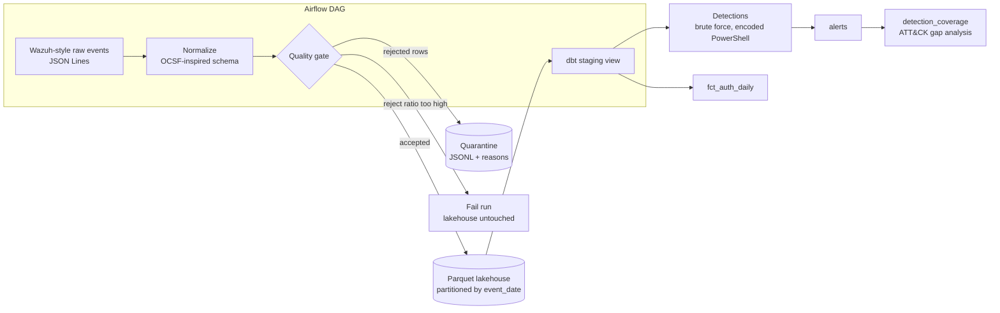

# Security Telemetry Lakehouse

[](https://github.com/ArgenFLT/security-telemetry-lakehouse/actions/workflows/ci.yml)

A small, fully reproducible **security data engineering** project: raw Wazuh-style alerts go through a
validated normalization step into a partitioned **Parquet lakehouse**, and **dbt** models on **DuckDB**
turn that telemetry into detections and a **MITRE ATT&CK coverage** report. An **Airflow** DAG
orchestrates the daily run.

It runs on a laptop with no external services: events are synthetic, deterministic and harmless.

## Why this project

Security teams are data teams in disguise. Detection quality depends on telemetry that is
complete, normalized and trustworthy. This repository demonstrates the data-engineering side of that
problem:

- **Normalization** to an [OCSF](https://ocsf.io)-inspired schema, so detections do not depend on one vendor's log format.
- A **data quality gate** that quarantines bad records and refuses to load a batch that is too dirty.
- **Detection logic as versioned SQL**, with tests, instead of rules buried in a console.
- **Coverage measurement** against ATT&CK, which is where data engineering meets purple teaming.

## Architecture



| Layer | Technology | Notes |
|---|---|---|
| Source | Synthetic generator (Python) | Seeded, with injected attack scenarios and a configurable share of corrupted lines |
| Normalization + quality | Python, PyArrow | Explicit schema, reject reasons, quarantine file, JSON quality report |
| Storage | Parquet, hive-partitioned | Idempotent: re-running a day replaces only that partition |
| Transformation | dbt + DuckDB | Staging view, detection tables, unified alerts, coverage; 19 data tests plus a detection regression test |
| Orchestration | Airflow DAG | `generate -> normalize (quality gate) -> dbt build` |
| CI | GitHub Actions | Lint, unit tests, and the full end-to-end demo |

## Quick start

Requires Python 3.10+.

```bash
git clone https://github.com/ArgenFLT/security-telemetry-lakehouse.git
cd security-telemetry-lakehouse
python -m venv .venv && source .venv/bin/activate
make install
make demo     # generate -> normalize -> dbt build (models + tests) -> coverage summary
make test     # unit tests
```

Inspect the results:

```bash
python - <<'EOF'
import duckdb
con = duckdb.connect("data/warehouse.duckdb", read_only=True)
for row in con.execute("""
    select alert_time, detection_name, severity, device_name, src_ip, user_name, details
    from alerts where severity in ('critical', 'high') order by alert_time
""").fetchall():
    print(row)
EOF
```

### Expected output (default seed)

The generator injects three scenarios into 24 hours of benign noise (about 12,000 events):

| Scenario | Detection | Result |
|---|---|---|
| SSH brute force from `203.0.113.45` that ends in a successful login | `Brute force authentication` | **critical** (followed by successful logon) |
| Windows logon brute force from `198.51.100.77` against `dc-01` | `Brute force authentication` | **high** |
| Encoded PowerShell launched by Word | `Encoded PowerShell command` | **critical** |

The same detection also fires **medium** alerts on an admin service account running
`-EncodedCommand` from `cmd.exe`. That noise is intentional: it is what real triage looks like, and
the natural next step is an allowlist (see roadmap).

`detection_coverage` joins the alerts to a seed of target ATT&CK techniques, so uncovered techniques
show up explicitly as `gap`:

| technique | detection | alerts | status |
|---|---|---|---|
| T1110 Brute Force | Brute force authentication | 2 | covered_firing |
| T1059.001 PowerShell | Encoded PowerShell command | 28 | covered_firing |
| T1078 Valid Accounts | none | 0 | gap |
| T1021.001 Remote Desktop | none | 0 | gap |
| T1003 OS Credential Dumping | none | 0 | gap |
| T1053.005 Scheduled Task | none | 0 | gap |

## Design decisions

- **Quality gate before load.** Rejected records are written to `data/quarantine/` with machine-readable
  reasons (`invalid_json`, `invalid_timestamp`, `missing_device_name`, ...). If the reject ratio exceeds
  the threshold (default 5%), the run fails *before* touching the lakehouse, so downstream models never
  read a bad batch. The report is always written for diagnosis.
- **Idempotent partitions.** Output is partitioned by `event_date` and written with delete-matching
  semantics, so retries and backfills are safe.
- **OCSF-inspired, not full OCSF.** Class and category IDs (Authentication 3002, Process Activity 1007),
  activity and status vocabularies, and severity mapping follow OCSF; the schema is flattened for
  columnar storage and simple SQL.
- **DuckDB for the warehouse.** Zero infrastructure and fast enough to make the project reproducible by
  anyone. The SQL is plain enough to port to BigQuery or Snowflake with small changes.
- **Detections as tested SQL.** `tests/assert_synthetic_attacks_detected.sql` is a regression test: if a
  detection change stops catching an injected scenario, the build fails. Exclude it on real data with
  `--exclude tag:synthetic`.
- **Safe by construction.** Attacker addresses use RFC 5737 documentation ranges and the encoded
  PowerShell payload only prints a string.

## Repository layout

```
src/stl/            generator, normalization, quality gate, pipeline, CLI
dbt_project/        staging, detections, alerts, coverage, seeds, tests
dags/               Airflow DAG
tests/              pytest suite (generator, normalization, pipeline, quality gate)
.github/workflows/  CI
```

## Running with Airflow

```bash
pip install apache-airflow
export STL_PROJECT_DIR=$(pwd)
export AIRFLOW__CORE__DAGS_FOLDER=$(pwd)/dags
airflow standalone
```

The DAG `security_telemetry_daily` appears in the UI. `make demo` does not require Airflow.

## Limitations

- Data is synthetic; formats follow Wazuh and Sysmon conventions but are not captured from real hosts.
- The brute force detection uses tumbling 10-minute windows, so an attack straddling a boundary can be split.
- The Airflow DAG is provided as the orchestration layer and is not exercised by CI.

## Roadmap

- [ ] Replace the generator with a real Wazuh archive or Kafka consumer
- [ ] Sliding-window brute force detection and a service-account allowlist
- [ ] Detections authored as Sigma rules, converted and tested
- [ ] Object storage (S3 or MinIO) instead of local disk
- [ ] Data quality checks with Great Expectations or dbt-expectations
- [ ] Dashboard (Grafana or Superset) on top of `alerts` and `detection_coverage`
- [ ] Docker Compose for Airflow

## License

MIT
